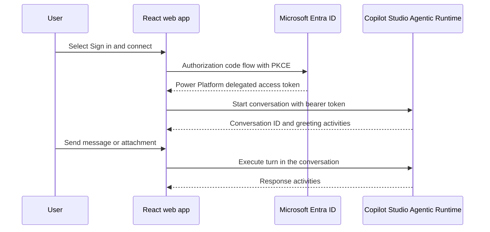

# Marketing Agent Web

A React and TypeScript reference application for embedding an authenticated
Microsoft Copilot Studio agent in a custom web page.

The application uses:

- [Microsoft Authentication Library for JavaScript](https://github.com/AzureAD/microsoft-authentication-library-for-js)
  to sign users in with Microsoft Entra ID.
- [`@microsoft/agents-copilotstudio-client`](https://www.npmjs.com/package/@microsoft/agents-copilotstudio-client)
  to communicate with the authenticated Copilot Studio Agentic Runtime.
- [`@microsoft/agents-activity`](https://www.npmjs.com/package/@microsoft/agents-activity)
  for message and attachment payloads.
- A native React transcript and composer, including multi-file attachments.

## How the integration works



The browser requests this Power Platform scope:

```text
https://api.powerplatform.com/.default
```

The access token is kept in MSAL session storage and passed to
`CopilotStudioClient`. No client secret is used or stored in the browser.

## Prerequisites

- Node.js 20 or later.
- A published Microsoft Copilot Studio agent.
- The agent's authenticated Agentic Runtime conversation URL.
- Permission to create or configure a Microsoft Entra app registration.
- A user account with access to the Power Platform environment and agent.

## 1. Create the Microsoft Entra app registration

1. Open the [Microsoft Entra admin center](https://entra.microsoft.com).
2. Go to **Identity > Applications > App registrations**.
3. Select **New registration**.
4. Enter a name such as `Marketing Agent Web`.
5. Select **Accounts in this organizational directory only** unless your
   deployment explicitly requires multitenant access.
6. Select **Register**.
7. Copy both values from **Overview**:
   - **Application (client) ID** identifies the web application.
   - **Directory (tenant) ID** identifies the Entra tenant.

These are different values and are both required.

## 2. Configure SPA authentication

1. In the app registration, open **Authentication**.
2. Select **Add a platform > Single-page application**.
3. Add the local redirect URI:

   ```text
   http://localhost:5173
   ```

4. Add each production origin as another SPA redirect URI when deploying.
5. Leave implicit grant and hybrid flows disabled.
6. Select **Save**.

Do not create a client secret for this SPA. MSAL uses authorization code flow
with PKCE.

## 3. Assign the Copilot Studio permission

1. Open **API permissions** in the app registration.
2. Select **Add a permission > APIs my organization uses**.
3. Search for **Power Platform API**.
4. If it is not shown by name, search for its application ID:

   ```text
   8578e004-a5c6-46e7-913e-12f58912df43
   ```

5. Select **Delegated permissions**.
6. Expand **CopilotStudio**.
7. Select **CopilotStudio.Copilots.Invoke**.
8. Select **Add permissions**.
9. Grant tenant-wide admin consent if required by your organization's policy.

The final permission should be:

| API | Permission | Type |
| --- | --- | --- |
| Power Platform API | `CopilotStudio.Copilots.Invoke` | Delegated |

## 4. Configure the application

Install dependencies and create a local environment file:

```powershell
npm install
Copy-Item .env.example .env
```

Update `.env`:

```dotenv
VITE_ENTRA_CLIENT_ID=YOUR_APPLICATION_CLIENT_ID
VITE_ENTRA_TENANT_ID=YOUR_DIRECTORY_TENANT_ID
VITE_AGENT_URL=https://YOUR_ENVIRONMENT.environment.api.powerplatform.com/copilotstudio/agenticruntime/3p/dataverse-backed/authenticated/bots/YOUR_AGENT_SCHEMA_NAME/conversations?api-version=2022-03-01-preview
```

The `.env` file is ignored by Git. Do not commit tenant-specific configuration
or credentials.

### Finding the agent URL

The authenticated conversation URL has this general form:

```text
https://<environment-host>/copilotstudio/agenticruntime/3p/dataverse-backed/authenticated/bots/<agent-schema-name>/conversations?api-version=2022-03-01-preview
```

Use the URL provided by Copilot Studio for the published agent. The value in the
URL is the agent schema name, not necessarily its display name.

## 5. Run locally

```powershell
npm run dev
```

Open [http://localhost:5173](http://localhost:5173), select **Sign in and
connect**, and choose an account in the configured tenant.

After connection:

1. The application starts an Agentic Runtime conversation.
2. The returned conversation ID is retained in React state.
3. Each message is sent as an Agents SDK `Activity`.
4. Agent response activities are rendered in the transcript.

## File attachments

The composer supports up to five files per turn, with a client-side limit of
4 MB per file. Each file is encoded as a data URL and sent as a standard
Agents SDK attachment containing:

- `contentType`: the browser-provided MIME type.
- `contentUrl`: the base64 data URL.
- `name`: the original filename.

The Copilot Studio agent must also be configured to accept and process file
uploads. If the agent or a channel policy rejects attachments, the UI displays
the service error.

For production workloads involving large or sensitive files, prefer uploading
files to an approved protected storage service and sending a short-lived,
authorized reference rather than increasing the inline size limit.

## Build and preview

```powershell
npm run build
npm run preview
```

The production output is generated in `dist/`. Configure the deployed HTTPS
origin as an SPA redirect URI in the Entra app registration.

## Project structure

```text
src/
  App.tsx       Chat UI, conversation lifecycle, messages, and attachments
  auth.ts       MSAL initialization and delegated token acquisition
  config.ts     Environment validation
  main.tsx      React entry point
  styles.css    Responsive light and dark styling
```

## Security notes

- Never place a client secret, certificate, or app-only token in this SPA.
- Keep `.env` out of source control.
- Restrict the Entra app to the intended tenant unless multitenant access is
  explicitly required.
- Use delegated least-privilege permission
  `CopilotStudio.Copilots.Invoke`.
- Production hosting must use HTTPS.
- Browser users must independently have permission to access the target Power
  Platform environment and agent.

## Troubleshooting

### The login page references the wrong tenant

Verify that `VITE_ENTRA_TENANT_ID` contains the **Directory (tenant) ID**, not
the Application (client) ID. Clear the site's session storage or restart the
browser if an account from a different tenant was previously cached.

### `AADSTS50020` or the account does not exist in the tenant

The selected account is not a member or guest of the configured tenant. Sign in
with an account from that tenant or invite the account as a guest according to
your organization's policy.

### Consent or insufficient-permission errors

Confirm that the Entra application has the delegated Power Platform API
permission `CopilotStudio.Copilots.Invoke`, and grant admin consent if required.

### Authentication works but conversation creation fails

Confirm all of the following:

- The agent is published.
- `VITE_AGENT_URL` is the authenticated Agentic Runtime conversation URL.
- The signed-in user can access the environment and agent.
- The token is requested for `https://api.powerplatform.com/.default`.

### Attachments are rejected

Confirm that file upload is enabled and supported by the Copilot Studio agent.
Also check file type, data-loss-prevention policies, and the 4 MB client limit.
